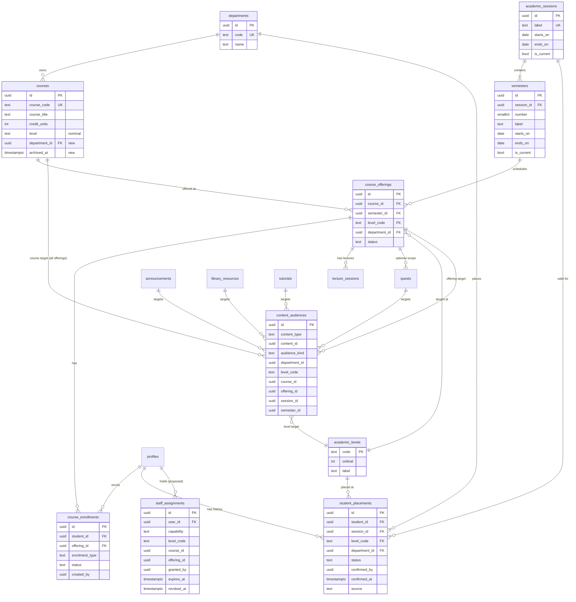

# 02 — Academic Data Model and ERD Proposal

**Status:** proposal only. No migration has been written or executed.

## 1. Does the existing schema support the required concepts?

| Concept | Supported today? | Evidence | Proposal |
|---|---|---|---|
| Academic levels | ⚠️ Text CHECK only | `profiles.level`, `courses.level` (`001:13,24`) | `academic_levels` reference table (keep text codes for FK compatibility) |
| Academic sessions | ❌ | – | `academic_sessions` |
| Semesters | ❌ | – | `semesters` (child of session) |
| Course catalogue | ⚠️ `courses` mixes catalogue with level | `courses.level`, `department` text | Keep `courses` as the **catalogue**; add `department_id`, `archived_at`; treat `level` as *nominal level* |
| Course offerings | ❌ | – | `course_offerings` (course × semester × level) |
| Student academic placement | ⚠️ Single mutable `profiles.level` from client metadata | `011:56-69` | `student_placements` (per session, verified); `profiles.level` becomes a cached current value |
| Course enrolment | ❌ | – | `course_enrollments` (student × offering) |
| Level-specific announcements | ❌ (scope label with no target) | `001:69` | Audience model (§4) |
| Level-specific timetables | ❌ (lectures link to a course only) | `001:38` | `lecture_sessions.offering_id` |
| Level-specific quests | ❌ | `018:21-31` | Audience model plus `quests.offering_id` / `semester_id` |
| Academic resource access | ❌ | – | Library and Tutorials audience tables |

**Decision:** extend existing tables with **nullable** columns and add new relational entities. Do not rename, drop or re-key any existing table. The existing `courses.id` UUIDs stay the catalogue keys, so every current foreign key keeps working.

## 2. Catalogue vs offering

| | `courses` (catalogue) | `course_offerings` (instance) |
|---|---|---|
| Meaning | "GET209 Engineering Mathematics I exists, 3 units" | "GET209 is taught in First Semester 2025/2026 to 200-level" |
| Lifetime | Stable across years; archived, never deleted | One per course × semester × level |
| Owns | Code, title, units, nominal level, department | Lectures, course-scoped announcements, quests, library and tutorial audiences, enrolments, course content managers |
| Example of why it matters | Carry-over: a 300-level student is enrolled in the 200-level GET209 offering. Shared course: an ENT course offered to several levels in the same semester = two offerings, same catalogue row. | |

## 3. Proposed ERD

### Key constraints (proposed)

| Table | Constraint |
|---|---|
| `academic_sessions` | `unique(label)`; partial unique index `where is_current` (only one current session); `check (starts_on < ends_on)` |
| `semesters` | `unique(session_id, number)`; one current semester (partial unique); dates within the session (trigger) |
| `course_offerings` | `unique(course_id, semester_id, level_code)`; `status in ('planned','active','completed','cancelled')` |
| `student_placements` | `unique(student_id, session_id)`; `status in ('claimed','confirmed','rejected')`; only `confirmed` placements grant level-scoped access |
| `course_enrollments` | `unique(student_id, offering_id)`; `enrolment_type in ('core','carryover','elective','audit')`; `status in ('active','dropped','completed')` |
| `content_audiences` | `check` that exactly the columns relevant to `audience_kind` are set; FK per target; index `(content_type, content_id)` and per-target indexes |
| `courses` | `on delete restrict` for new FKs. Archive with `archived_at` instead of deleting (fixes the cascade risk noted in the parent audit). |

### Existing tables: additive changes only

| Table | New nullable columns | Backfill |
|---|---|---|
| `profiles` | `department_id` | the Civil Engineering row (unambiguous) |
| `courses` | `department_id`, `archived_at` | Civil Engineering; archived_at null |
| `lecture_sessions` | `offering_id` | from `course_id` + the semester containing `lecture_date` + `courses.level` (flag rows outside any semester) |
| `announcements` | `session_id`, `semester_id` (optional) + `content_audiences` rows | from `scope` (see doc 03) |
| `quests` | `offering_id`, `semester_id` + audiences | legacy → flagged for admin decision (doc 03) |
| `study_sessions` | `semester_id` (optional) | derived from `study_date` when semester ranges exist |
| `xp_ledger` | `session_id`, `semester_id`, `level_code_at_award` | derived from `created_at` and the placement at that time; ambiguous rows flagged |

## 4. Unified audience model

Rather than adding level and department columns to every content table (which bloats and duplicates the RLS logic), every audience-targeted table gets rows in **`content_audiences`**:

| `audience_kind` | Fields | Meaning |
|---|---|---|
| `department` | `department_id` (+ optional `session_id`/`semester_id`) | Everyone with a confirmed placement in the department |
| `level` | `level_code` (+ optional session or semester) | Students with a confirmed placement at that level in the referenced (or current) session |
| `course` | `course_id` | Students enrolled in **any** offering of that catalogue course (useful for shared resources across years) |
| `offering` | `offering_id` | Students enrolled in that specific offering |
| `staff_only` | – | Visible only to staff with the relevant capability |

A content row is visible if **any** of its audience rows matches the reader (OR semantics). Multiple rows are how **cross-level sharing is authorised explicitly**: a 300-level resource also shared with 200-level gets two `level` rows. An item with **no** audience rows is visible to **no student** (safe default; "public by accident" is impossible).

Alternative considered: per-module audience tables (`library_resource_audiences`, `tutorial_audiences`, …). That gives typed FKs per content table but duplicates the helper logic. **Recommendation:** use per-module audience tables with an identical column shape plus one shared SQL helper `audience_matches(level_code, course_id, offering_id, department_id, session_id, semester_id)`, so that real FKs (with `on delete cascade` to the content row) and RLS performance are both preserved. The ERD's `content_audiences` shows the shared shape.

## 5. Helper functions (proposed, SECURITY DEFINER, `stable`, hardened `search_path`)

| Function | Returns | Used by |
|---|---|---|
| `current_session_id()` / `current_semester_id()` | uuid | Defaults, dashboards |
| `my_access_context()` | row(`is_admin`, `verification_status`, `department_id`, `level_code`, `session_id`) | App and RLS |
| `is_verified_student()` | bool | Every student-write policy (closes BP-005) |
| `my_offering_ids()` | setof uuid | Audience checks (enrolments) |
| `audience_matches(...)` | bool | Content RLS |
| `can_view_library_resource(id)`, `can_view_tutorial(id)`, `can_view_announcement(id)`, `can_view_quest(id)` | bool | RLS and server-side signed-URL minting |
| `has_capability(cap, level_code, course_id, offering_id)` | bool | Staff write policies (doc 06) |

All functions must be `stable`, use `(select auth.uid())` patterns for planner caching, and have indexes on `student_placements(student_id, session_id)`, `course_enrollments(student_id, status)` and the audience target columns.
