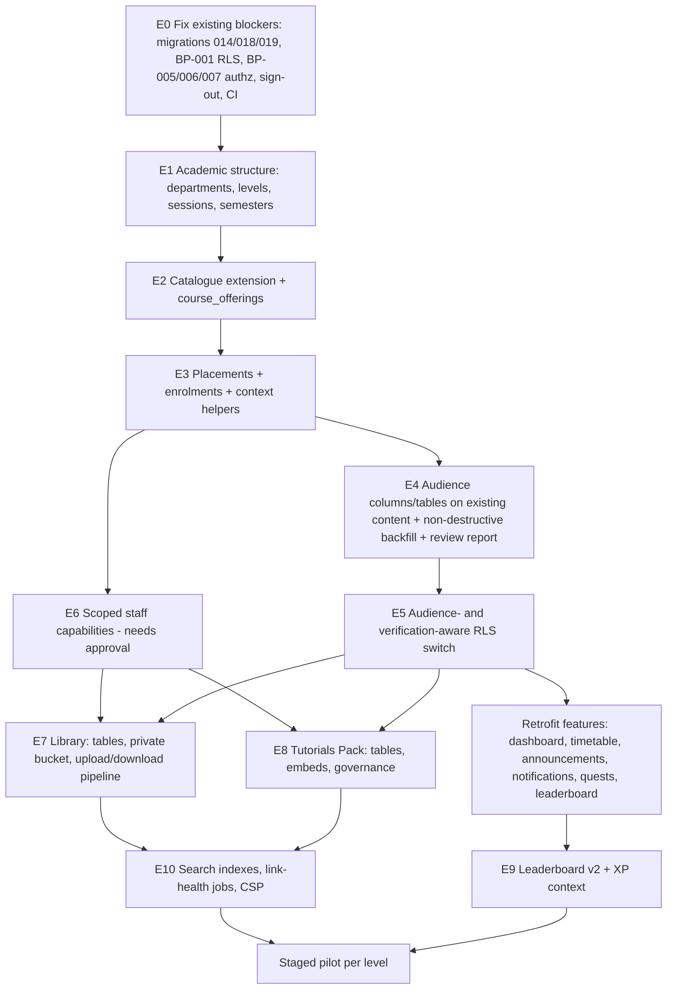

# 07 — Revised, Dependency-Aware Implementation Roadmap

This roadmap covers the original findings (BP-xxx) and the department-wide expansion together. **Nothing here is approved for implementation.** 🔐 marks steps that need human approval: remote DB, secrets, external services, new roles, policies.

## 1. Dependency graph

## 2. Required database migrations (proposed sequence)

| ID | Migration | Contents | Destructive? | Depends on |
|---|---|---|---|---|
| E0-a | Fix 014/018/019 syntax (in place if confirmed unapplied, else new) | Valid policy creation, string literal | No | Ledger check 🔐 |
| E0-b | Security corrections | RLS on verification history, view lockdown, `get_leaderboard` fix, submission insert hardening, `award_xp` revoke, trigger fixes (parent roadmap Phase 1) | No | E0-a |
| E0-c | Verification transitions | `request_reverification`, `admin_change_status` | No | E0-b |
| **E1** | `academic_structure` | `departments`, `academic_levels` (seed 100–500), `academic_sessions`, `semesters`, current-session constraints, RLS (read for authenticated, write for dept admin) | No | E0 |
| **E2** | `course_offerings` | `courses.department_id`, `courses.archived_at`, `course_offerings`, change new FKs to `restrict` | No | E1 |
| **E3** | `placements_enrolments` | `student_placements`, `course_enrollments`, `profiles.department_id`, helper functions (`my_access_context`, `is_verified_student`, `my_offering_ids`); stop trusting metadata in `handle_new_user` | No (the `handle_new_user` change is behavioural) | E2 |
| **E4** | `content_audiences` | Audience tables for announcements and quests; `lecture_sessions.offering_id`; `quests.offering_id/semester_id`; `study_sessions.semester_id`; backfills with `source='legacy_backfill'`; `admin_migration_review` view | No | E3 + admin-entered calendar 🔐 |
| **E5** | `audience_rls` | Replace select policies on lectures, announcements and quests with audience- and verification-aware policies. Reverse migration prepared. | Policy replacement (reversible) | E4 + review items resolved 🔐 |
| **E6** | `staff_capabilities` 🔐 | `staff_assignments`, `staff_assignment_events`, `has_capability()`, two-person rule for department admin | No | E3, approval |
| **E7** | `library` | Library tables, private bucket `library`, constraints, RLS, `pg_trgm` + GIN search index | No | E5 (+ E6 if delegated) |
| **E8** | `tutorials` | Tutorials, playlists, saves, progress, reports, review events, provider domain allow-list, publication triggers | No | E5 (+ E6) |
| **E9** | `leaderboard_v2` | `xp_ledger.session_id/semester_id/level_code_at_award` + backfill; `get_leaderboard(p_period, p_level, p_session)` returning bigint, verified-only | No | E3, E0-b |
| **E10** | `hardening` | `NOT NULL` on verified backfilled columns (e.g. `lecture_sessions.offering_id`); additional indexes | Constraint tightening only | One stable release after E5 |

## 3. Capability classification (infrastructure needs)

| Capability | Existing infra | DB migration | External service | New dependency |
|---|---|---|---|---|
| Levels, sessions, semesters, offerings, placements, enrolments | ✅ | E1–E3 | – | – |
| Audience-based visibility | ✅ (RLS) | E4–E5 | – | – |
| Scoped admin permissions | ✅ | E6 | – | – |
| Library metadata, bookmarks, reports | ✅ | E7 | – | – |
| Private file storage, signed URLs | ✅ Supabase Storage | E7 (bucket) | – | – |
| Direct large uploads | ✅ `createSignedUploadUrl` | – | – | – |
| Magic-byte validation | – | – | – | `file-type` (or a hand-written check) |
| Malware scanning | – | – | ClamAV container / scanning API 🔐 | – |
| PDF preview | ✅ browser viewer | – | – | optional `pdfjs-dist` |
| PPTX/DOCX preview | – | – | Conversion service (LibreOffice/Gotenberg) 🔐, or **download-only (recommended v1)** | – |
| Full-text and fuzzy search | ✅ Postgres FTS + `pg_trgm` | E7/E8 | – | – |
| YouTube embed | ✅ iframe | E8 | YouTube (public) | – |
| YouTube watch-progress | ✅ IFrame API script | E8 | YouTube | – |
| Video title and duration auto-fill | – | – | YouTube Data API v3 key 🔐 (oEmbed for title only) | – |
| Self-hosted lecturer or AI videos | Supabase Storage (egress cost) | E8 | Optional unlisted YouTube/Vimeo or a video CDN 🔐 | – |
| Link-health checks | ✅ cron route + pg_cron | E8 | – | – |
| CSP for embeds and storage | ✅ `next.config.ts` headers | – | – | – |
| Department-wide notification targeting | ✅ pipeline | E3–E5 | – | – |
| Level/session leaderboard | ✅ | E9 | – | – |

## 4. Phased plan

| Phase | Work | Exit criteria |
|---|---|---|
| **E0. Stabilise (prerequisite)** | Parent roadmap Phases 0–2 plus 3.1 (sign-out). CI (typecheck, lint, test, build, `supabase db` tests). Secret rotation 🔐. | Migrations 001–019 apply on a clean DB; RLS suite green; no Critical or High findings open in authorization or DB |
| **E1–E3. Academic structure** | Migrations E1–E3. Admin UIs: sessions and semesters, offerings, placements (bulk-confirm), enrolments (auto-enrol core and carry-over). Registration no longer sends level or department; the student requests a placement, staff confirm. | Admin can model 100–500 for the current session; placements confirmed for the pilot cohort |
| **E4–E5. Retrofit core features** | Backfill and review report 🔐. Audience pickers in announcement, quest and lecture forms. Dashboard, timetable, study-planner course lists, notifications targeting (SQL-side, includes carry-overs), quests. Switch RLS. | Cross-level isolation tests pass (a student at level X sees only X plus explicitly shared content) |
| **E6. Permissions** 🔐 | Approval of the capability set. Implement department admin, library manager and tutorial curator first. | Capability × table pgTAP matrix green; grant audit log working |
| **E7. Library** | Private bucket, signed upload and download, versioning, metadata and audiences, search and filters, PDF preview, bookmarks, recent and related, reports and takedown, copyright attestation. | Storage advisor clean; no authenticated storage policies on `library`; E2E: upload → publish → student download (other level denied) |
| **E8. Tutorials Pack** (parallel with E7) | URL parser and validator, embeds, CSP, saves, playlists, progress (manual first, IFrame API second), reports, AI governance gate, link-health job. | AI item cannot publish without an independent reviewer (DB-tested); embeds blocked for non-allow-listed hosts |
| **E9. Leaderboard v2 and quests per level** | XP context, scoped leaderboards, level and offering quests | Leaderboard correct per level, session and semester; verified-only |
| **E10. Hardening and rollout** | Constraint tightening, monitoring, privacy notice update (embeds, analytics), content policy approval 🔐, staged rollout: 200 → 300 → others | Roadmap exit criteria from the parent audit, plus this phase's checks, met per level |

## 5. Decisions required from the project owner or department (blocking)

1. Official level range, and whether 100-level is departmental or faculty-wide (doc 01 §3).
2. The current session label, semester names and dates, and the course-to-semester mapping for the existing 7 courses.
3. Approval of the scoped capability model and who will hold each capability.
4. Library copyright policy, the past-question approval process, and the takedown SLA.
5. Whether malware scanning, a document-conversion service, the YouTube Data API key and video hosting are approved (cost and privacy).
6. The AI-generated content policy and the reviewer pool.
7. Which content pending or rejected students may read.
8. Confirmation of the remote migration ledger before any schema work (parent Phase 0).

**Overall verdict remains NO-GO** for any deployment. The expansion is architecturally feasible, but it depends on first fixing the existing Critical and High findings, because those defects would affect five times as many users after the pivot.
