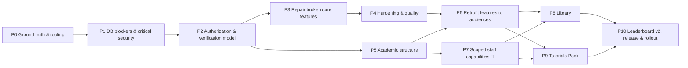

# BLUEPRINT Implementation Plans: Phase Index

**Source specs:**
- Original audit: `docs/independent-audit-2026-11-23/` (findings BP-001…BP-058; `REMEDIATION_ROADMAP.md`)
- Department-wide expansion: `docs/independent-audit-2026-11-23/department-expansion/` (docs 01–07; migrations E0–E10)

**Status:** plans only. **No phase is approved for execution.** Each phase needs explicit approval before work starts. Steps marked 🔐 need a human with production access, credentials or policy authority.

## Phase order and dependencies

| Phase | Plan file | Delivers | Audit refs | Migrations | Gate to start |
|---|---|---|---|---|---|
| P0 | `2026-11-23-p00-ground-truth-and-tooling.md` | Ledger facts, deps installed, local Supabase + pgTAP, Playwright, CI | Testing report, BP-034/035/057 | – | Approval |
| P1 | `2026-11-23-p01-database-blockers-and-critical-security.md` | Migrations apply cleanly; verification-history RLS; leaderboard RPC; quest/profile integrity | BP-001/002/003/004/014/015/016/017/018/043/044/045/046 | fix 014/018/019, 020–023 | P0 done |
| P2 | `2026-11-23-p02-authorization-and-verification-model.md` | Correct roles; verification-state enforcement; resubmit/suspend flows | BP-005/006/007 | 024–025 | P1 done |
| P3 | `2026-11-23-p03-repair-broken-core-features.md` | Sign-out, quests, leaderboard, admin verification, notifications, service worker, course CRUD | BP-008…013/023…030/041/042 | 026–027 | P2 done |
| P4 | `2026-11-23-p04-hardening-and-quality.md` | Open redirect, error mapping, avatars, error boundaries, a11y, dates, CSP, generated types | BP-019(part)/020/021/022/026/031/036–040/047–053/055 | 028 | P3 done |
| P5 | `2026-11-23-p05-academic-structure.md` | Sessions, semesters, offerings, placements, enrolments + admin UIs | Expansion E1–E3 | 030–032 | P2 done + calendar decisions 🔐 |
| P6 | `2026-11-23-p06-retrofit-features-to-audiences.md` | Audience model, legacy backfill + review, audience RLS, scoped student views, SQL targeting | Expansion E4–E5 | 033–035 | P4 + P5 done |
| P7 | `2026-11-23-p07-scoped-staff-capabilities.md` | `staff_assignments`, `has_capability`, scoped write policies, staff UI | Expansion E6 | 036 | P5 done + **role approval 🔐** |
| P8 | `2026-11-23-p08-library.md` | Private document library end-to-end | Expansion doc 04 | 037 | P6 + P7 + copyright policy 🔐 |
| P9 | `2026-11-23-p09-tutorials-pack.md` | Tutorials, embeds, playlists, progress, AI governance | Expansion doc 05 | 038 | P6 + P7 + AI content policy 🔐 |
| P10 | `2026-11-23-p10-leaderboard-v2-release-and-rollout.md` | Scoped leaderboard, constraint tightening, E2E suite, observability, deployment, staged rollout | E9–E10, Deployment doc | 039–040 | P8 + P9 done |

P8 and P9 can run in parallel. P5 can start once P2 is done, in parallel with P3/P4, if staffing allows.

## Conventions shared by every plan

- **Branching:** one branch per phase, `phase/pNN-<slug>`, merged to `master` via PR after CI is green and review passes.
- **Migrations:** `supabase/migrations/NNN_<snake_name>.sql`, continuing the existing 3-digit numbering. **Implementation ruling (P1 Task 6):** the Supabase CLI accepts only purely numeric version prefixes, so suffixes such as `023b`/`033b`/`035b` are invalid. Every migration takes the next free integer when it is written; the numbers in these plans are labels, and the actual file is found by name (`ls supabase/migrations`). Never edit a migration that the P0 ledger shows as applied remotely. Every migration is additive or ships with a reverse file in `supabase/rollback/NNN_<name>_down.sql`.
- **DB tests:** pgTAP files in `supabase/tests/database/NNN_<topic>.test.sql`, run with `supabase test db`. Shared helpers from P0 Task 3 (`tests.create_user`, `tests.authenticate_as`, `tests.as_anon`, `tests.make_admin`).
- **App tests:** `node:test` via `npm test` (`tsx --test`), colocated in `__tests__/` next to the code.
- **E2E tests:** Playwright in `e2e/*.spec.ts`, run with `npm run e2e -- --trace off`, against `supabase start` + `next dev`.
- **Next.js:** before using any Next API, read the matching guide in `node_modules/next/dist/docs/` (AGENTS.md: "This is NOT the Next.js you know").
- **Commit per task**, with a conventional message referencing the finding IDs, e.g. `fix(db): enable RLS on verification history (BP-001)`.
